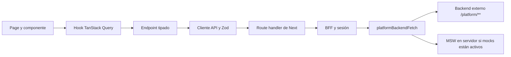

# Estructura y arquitectura

Análisis del código local realizado el 2 de octubre de 2026. Describe la implementación
actual; no acredita que los contratos propuestos estén implementados en el backend externo.

## Propósito y tecnologías

Panel privado de administración de ClinicFlow360 para operadores KodeWave: clínicas,
suscripciones, planes, módulos, especialidades, overrides y auditoría.

`package.json` declara Next.js 15.5.27, React 19.1, TypeScript 5.9 en modo estricto,
Tailwind CSS 4, Radix/shadcn, TanStack Query/Table, React Hook Form y Zod 4.
Pruebas con Vitest, Testing Library, MSW y Playwright. Requiere Node 22 o superior
y declara `pnpm@12.4.2`; las versiones de dependencias se fijan en el manifiesto y lockfile.

## Mapa de carpetas

```text
src/
  app/
    (app)/                  rutas autenticadas y layout compartido
    login/                  página y formulario de inicio de sesión
    api/auth/               login, MFA y logout del BFF
    api/platform/[...path]/ proxy de recursos de plataforma
    providers.tsx           QueryClient y notificaciones
    globals.css             tokens y estilos globales
  components/
    clinics/                dashboard, clínicas, acciones y overrides
    plans/                  planes, edición y matriz de módulos
    modules/                catálogo, formulario y dependencias
    audit/                  filtros, eventos y detalle de cambios
    layout/                 shell, navegación, breadcrumbs y paleta
    shared/                 diálogos y aviso de conflictos
    states/                 carga, vacío y error
    ui/                     primitivas y tabla/formulario reutilizables
    specialties-list.tsx    listado de especialidades
  lib/
    api/schemas/            contratos de entrada/salida y tipos inferidos
    api/endpoints/          adaptadores authApi y platformApi
    api/hooks/              consultas, mutaciones e invalidación
    api/client.ts          transporte navegador → BFF
    api/errors.ts          ApiError y clasificación de errores
    api/query-keys.ts      claves centralizadas de caché
    react-query.ts         políticas globales de consultas y sesión
    use-optimistic-version.ts control de versión de formularios
    use-search-params-updater.ts actualización coordinada de filtros URL
    forms.ts, dates.ts, format.ts, audit-diff.ts, dependency-graph.ts
  server/                   cookies, entorno, BFF y transporte al backend
  mocks/                    backend en memoria y reglas simuladas
  config/features.ts        flags públicos de mocks y MFA
  middleware.ts             control de presencia de cookie
test/                       renderWithClient, MSW y stub de server-only
e2e/                        recorridos de autenticación, clínicas y catálogo
.github/workflows/ci.yml     comprobaciones y E2E con mocks
docs/                       estructura, patrones y reglas
.agents/skills/clinicflow-control-center/ skill local versionada para este proyecto
AGENTS.md                   entrada de instrucciones para agentes
```

Las pruebas unitarias y de componentes se ubican junto al código como `*.test.ts(x)`.
El alias `@/` apunta a `src/` y `@test/` a `test/`.

## Proyecto detectado y alcance

La raíz actual contiene un solo proyecto independiente: `kodewave-control-center`, aplicación
web TypeScript/Next.js con BFF. No se detectaron manifiestos de otros proyectos ni submódulos
Git en esta ruta. `pnpm-workspace.yaml` configura instalación, pero no declara paquetes de un
monorepo. `src/`, `test/` y `e2e/` pertenecen a la misma aplicación.

La persistencia real y Spring Boot son externos; aquí no hay ORM ni migraciones. La integración
es HTTP hacia `PLATFORM_API_URL`, con simulación MSW en memoria. La infraestructura comprobada
es GitHub Actions y el servidor Next; no se detectaron Dockerfiles ni configuración de despliegue
que permitan afirmar un proveedor de producción. No se inspeccionaron proyectos hermanos fuera
de la raíz actual. Comandos y criterios de finalización: [FLUJO_IA.md](FLUJO_IA.md).

## Flujo de datos



Las páginas componen vistas y resuelven parámetros; la interacción se concentra en componentes
cliente. Ejemplo: [`ClinicPage`](<../src/app/(app)/clinicas/[clinicId]/page.tsx>) entrega el ID
a [`ClinicDetail`](../src/components/clinics/clinic-detail.tsx).

El [`cliente API`](../src/lib/api/client.ts) valida respuestas con Zod y normaliza fallos como
`ApiError`. Los [`endpoints`](../src/lib/api/endpoints/platform.ts) definen método, cuerpo,
esquema y URL; los hooks gestionan caché y efectos posteriores a una mutación.

## Límites y sesión

[`bff.ts`](../src/server/bff.ts) concentra CSRF, login, MFA, logout y proxy. Los tokens se
guardan en cookies `kw_at`, `kw_rt`, `kw_mfa` con `httpOnly`, `Secure` y `SameSite=Strict`.
El proxy bloquea el segmento `auth`, añade el Bearer en servidor y puede refrescar una vez
ante 401. La deduplicación del refresh usa memoria del proceso y una ventana de diez segundos;
no constituye coordinación entre instancias.

[`middleware.ts`](../src/middleware.ts) comprueba presencia de cookies, no validez del JWT
ni permisos. El backend decide la autorización. La caché de consultas redirige al login
cuando recibe `UNAUTHENTICATED` o `PLATFORM_FORBIDDEN`.

La aplicación importa contratos y hooks; los route handlers llaman a `server/`.
ESLint restringe imports de `@/server/*` y `@/mocks/*` desde app, componentes y lib,
con la excepción de servidor para `src/app/api/**/*.ts` y exclusión de tests.
El middleware puede usar los helpers de sesión porque está fuera de esos globs.

## Backend simulado y validación

[`platform-backend.ts`](../src/server/platform-backend.ts) selecciona backend real o
[`resolveMockRequest`](../src/mocks/resolve.ts). En ejecución mock se conserva el BFF;
MSW resuelve el request en servidor y la base simulada vive en memoria.
En tests de componentes, [`test/render.tsx`](../test/render.tsx) monta handlers directamente
en `/api` con `skipAuth`, por lo que esos tests no prueban el BFF ni la autorización.
Las pruebas específicas de BFF y los E2E complementan esa cobertura.

Playwright construye e inicia la app en el puerto 3100, con mocks y MFA habilitados.
CI ejecuta tipos, lint, formato, Vitest, build y después E2E en Chromium.

## Alcance del análisis y puntos de atención

- Se revisaron manifiestos, configuración, README y las capas descritas. Graphify examinó
  142 archivos de código en `src/`, con 707 nodos y 2069 relaciones; CSS e icono quedaron
  fuera de esa extracción y los estilos se inspeccionaron directamente.
- El diagnóstico del grafo resultante no reportó aristas con extremos ausentes ni bucles.
  La extracción fue estructural, sin llamadas a un LLM externo; no es una auditoría de seguridad.
- La autoridad sobre módulos efectivos reside en el backend. La implementación equivalente
  de `src/mocks/effective.ts` sirve al backend falso, no debe trasladarse a la UI.
- La integración Spring Boot no se verificó. El README denomina varios contratos como propuestos.
- Al analizar este checkout no había `node_modules`; el pnpm disponible era 11.25.0 frente
  al 12.4.2 declarado. No se ejecutaron pruebas de aplicación ni build en este análisis documental.
- Los archivos grandes de handlers y BFF son puntos de impacto compartido. Una separación
  futura debe conservar cookies, errores, versiones y reglas de negocio; no se requiere
  reestructurarlos para cada cambio.
